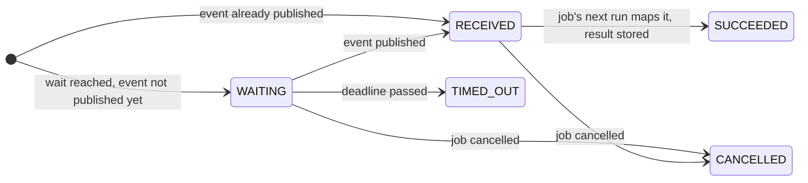

# Events

A handler can wait for an event as a durable step. If the event hasn't been published yet, the
attempt ends and the job is suspended in state `WAITING`, without holding a thread or a concurrency
slot. Publishing the event resumes it, and the handler runs again from the top: completed steps are
skipped, and the wait now returns the event's payload, or the result an event handler maps it to.
Like a step, the wait stores that result: later runs return it without the event.

## Waiting and publishing

```java
bikesched.registerJobHandler("order", job -> {
    Order order = job.payload(Order.class);
    Payment payment = job.waitForEvent("await-payment", "payment-received", order.id())
            .receive(Payment.class);
    job.step("ship", Void.class, _ -> { shipping.ship(order, payment); return null; });
});

// e.g. in a payment webhook; .connection(connection) publishes in your own transaction
List<ReceivedEvent> received = bikesched.newEvent("payment-received", order.id())
        .payload(payment)
        .publish();   // the steps that received the event, with their job ids
```

- An event is identified by its name and key and goes to every step waiting for it.
- `receive(Payment.class)` returns the payload mapped by the `JsonMapper` and stores it as the
  step's result.
- `receive(Receipt.class, event -> …)` maps the whole `Event` (name, key, payload) with an event
  handler and stores its result instead, see [Event handlers](#event-handlers).
- Events are stored in `bikesched_events` for their retention. A step that starts waiting after the
  event was published receives the latest one whose retention has not passed, right away. See
  [Retention](#retention).
- Waiting does not use up an attempt.
- Code outside steps runs again on every resume, so it must be cheap and deterministic.

## Lifecycle

How a job and its wait step move through their states, from waiting to the stored result:



1. **The handler reaches the wait.** If no matching, unexpired event exists, the step is created
   `WAITING` (with `wait_until` if it has a timeout). The attempt ends: the job becomes `WAITING`,
   due at the deadline (or never without one), its lock is released and the attempt is given back,
   so waiting does not count as an attempt.
2. **The event is published.** In one transaction, holding the advisory lock on name and key:
   - the event is inserted with its expiry (`expires_at`);
   - every step `WAITING` for that name and key becomes `RECEIVED` and references the event
     (`event_id`); the payload is not copied;
   - every job `WAITING` at such a step becomes `SCHEDULED`, due now;
   - `publish()` returns the steps that received the event.

   A job that is still `RUNNING` at that moment (it is just suspending) is left alone: suspending
   finds its step `RECEIVED` and schedules the job right away instead of letting it wait.
3. **A node claims the job.** It becomes `RUNNING` with a new attempt, and its handler runs from
   the top: completed steps return their stored results, then the wait finds its step `RECEIVED`,
   loads the event, maps it (with the event handler, or the payload as it is for
   `receive(Class)`), stores the result and marks the step `SUCCEEDED`, all before `receive`
   returns. From then on, the step no longer needs the event, and the event clean-up may delete it
   once it has expired.
4. **The handler continues** after the wait and the job ends as usual, e.g. `SUCCEEDED`, or it
   waits again at the next wait.

Other paths:

- **Published before the wait:** the step is created `RECEIVED` right away, and the same run maps
  the event; the job is never suspended.
- **The event handler throws:** the attempt fails as with any exception; the step stays `RECEIVED`,
  and the retry maps the event again (the event is kept until then).
- **Timeout:** the job becomes due at `wait_until`. Its next run finds the deadline passed and marks
  the step `TIMED_OUT`; `receive` returns the timeout handler's result, on this and every later run.
- **Cancellation:** cancelling the job marks a `WAITING` or `RECEIVED` step `CANCELLED`; it no
  longer receives events, and a referenced event is no longer kept for it.
- **Later runs** (after another wait or a retry) return the stored result of a `SUCCEEDED` wait
  without the event.

With the [job history](jobs.md#job-history) enabled, each of these changes is recorded.

## Event handlers

An event handler maps the received event to the wait's result, like a step handler:

```java
Receipt receipt = job.waitForEvent("await-payment", "payment-received", order.id())
        .receive(Receipt.class, event -> Receipt.of(event.payload(Payment.class)));
```

- Publishing marks the waiting step `RECEIVED` and only references the event (`event_id`); the
  payload is not copied. The job's next run calls the handler and stores its result (mapped by the
  `JsonMapper`, hence the result class), and the step becomes `SUCCEEDED`.
- Later runs return the stored result without calling the handler again. If the handler throws,
  the attempt fails, the step stays `RECEIVED`, and the next attempt calls it again.
- The event is kept while a step still needs it (see [Retention](#retention)).

## Typed events

An `EventType` names an event together with its payload class, shared by the publisher and the
waiting jobs:

```java
static final EventType<Payment> PAYMENT_RECEIVED = EventType.of("payment-received", Payment.class);

Payment payment = job.waitForEvent("await-payment", PAYMENT_RECEIVED, order.id())
        .timeout(Duration.ofDays(3), () -> null)   // optional; the result type is already known
        .receive();

bikesched.newEvent(PAYMENT_RECEIVED, order.id()).payload(payment).publish();   // payload(Payment) only
```

Only the name is stored, so events published with the string-based API reach typed waits and vice
versa. Like job payloads, event payloads should be objects rather than bare values or collections,
see [Payload design](configuration.md#payload-design).

## Timeouts

To stop waiting after a while, add a timeout; its handler's result is returned instead of the
event. Unlike an event handler's result, it is not stored: the timeout handler runs every time the
job's handler reaches the timed-out wait, so it should only produce a fallback:

```java
Payment payment = job.waitForEvent("await-payment", "payment-received", order.id())
        .<Payment>timeout(Duration.ofDays(3), () -> null)   // the type is needed for a null result
        .receive(Payment.class);
```

Without a timeout of its own, a wait uses the node's `defaultEventTimeout`, if set: once it passes,
the job fails permanently with an `EventTimeoutException`.

## Retention

An event's retention only matters for steps that start waiting **after** it was published: steps
already waiting receive it when it is published, whatever its retention. It defaults to the
publishing node's `eventRetention` (7 days) and can be set per event:

```java
bikesched.newEvent("driver-accepted", rideId).payload(offer).retention(Duration.ofMinutes(5)).publish();
bikesched.newEvent("location-updated", rideId).payload(location).retention(Duration.ZERO).publish();
```

- The expiry (`expires_at`) is fixed when the event is published, so all nodes agree on it,
  whatever their own `eventRetention`.
- `Duration.ZERO` delivers the event only to the steps waiting right now; later waits never receive
  it. Useful for signals that make no sense once missed.
- Expired events are no longer received, and every polling node deletes them every
  `eventCleanUpInterval` (default 1 hour), except events that a `RECEIVED` step still needs because
  its job has not handled them yet. Once handled, the step keeps its result and the event's id.

## Consistency

Waiting, suspending and publishing lock the event's name and key for the length of their
transaction (a PostgreSQL advisory lock), so an event published while a job starts waiting is never
missed. Cancelling a waiting job marks its wait `CANCELLED` (also a `RECEIVED` one); it no longer
receives events.

---

Next: [Configuration](configuration.md) · Previous: [Recurring jobs](recurring-jobs.md) ·
[Documentation index](index.md)
