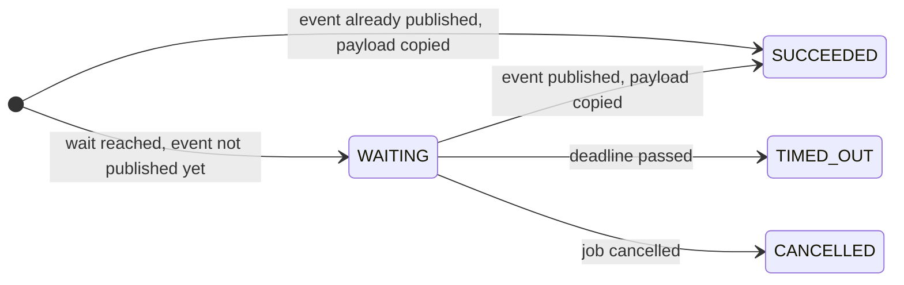

# Events

A handler can wait for an event as a durable step. If the event hasn't been published yet, the
attempt ends and the job is suspended in state `WAITING`, without holding a thread or a concurrency
slot. Publishing the event resumes it, and the handler runs again from the top: completed steps are
skipped, and the wait now returns the event's payload. Like a step, the wait stores it: publishing
copies the payload into the step, so later runs return it even after the event was deleted.

## Waiting and publishing

```java
bikesched.registerJobHandler("order", job -> {
    Order order = job.payload(Order.class);
    Payment payment = job.waitForEvent("await-payment", "payment-received", order.id(), Payment.class)
            .receive();
    job.step("ship", () -> shipping.ship(order, payment));
});

// e.g. in a payment webhook; .connection(connection) publishes in your own transaction
UUID eventId = bikesched.newEvent("payment-received", order.id())
        .payload(payment)
        .publish();   // the id of the published event, e.g. to log it or store it with your data
```

- An event is identified by its name and key and goes to every step waiting for it.
- `receive()` returns the payload mapped to the class given to `waitForEvent` by the `JsonMapper`;
  the step stores the payload as it is.
- Payload that already is JSON text, e.g. a forwarded webhook body, goes in with
  `.payloadJson(body)` instead of `.payload(...)`: stored as it is, without the `JsonMapper` (a
  Jackson mapper would turn a `String` into a JSON string). Invalid JSON fails `publish()`.
- To derive something from the payload, do it after `receive`: a pure conversion can run again on
  every resume; anything with side effects belongs in a [step](steps.md) after the wait. To keep
  the stored copy small, keep the event's payload small (e.g. ids instead of whole documents).
- Events are stored in `bikesched_events` for their retention. A step that starts waiting after the
  event was published receives the latest one whose retention has not passed, right away. See
  [Retention](#retention).
- Waiting does not use up an attempt.
- Code outside steps runs again on every resume, so it must be cheap and deterministic.

### Idempotency keys

A webhook the provider delivers twice publishes the event twice. With an idempotency key, it is
published once:

```java
bikesched.newEvent("payment-received", order.id())
        .payload(payment)
        .idempotencyKey(webhook.deliveryId())
        .publish();   // a repeated delivery returns the first event's id
```

- While an event with the same name, key and idempotency key is kept (its
  [retention](#retention) has not passed), `publish` returns that event's id: nothing is stored,
  no waiting step receives anything, and the duplicate's payload is ignored. With a retention of
  `Duration.ZERO`, the key has no effect.
- The check runs under the advisory lock `publish` takes on name and key, so concurrent
  duplicates are published once, also with `.connection(connection)`.
- Keys have 1 to 500 characters. The [event listener](metrics.md#own-listeners) is not called
  for a duplicate.
- Events published by a job (`Job.newEvent`) have no key: their step publishes them once.

Jobs have the same option, see [Idempotency keys](jobs.md#idempotency-keys).

## Lifecycle

How a job and its wait step move through their states:



1. **The handler reaches the wait.** If no matching, unexpired event exists, the step is created
   `WAITING` (with `wait_until` if it has a timeout). The attempt ends: the job becomes `WAITING`,
   due at the deadline (or never without one), its lock is released and the attempt is given back,
   so waiting does not count as an attempt.
2. **The event is published.** In one transaction, holding the advisory lock on name and key:
   - the event is inserted with its expiry (`expires_at`);
   - every step `WAITING` for that name and key becomes `SUCCEEDED`, with a copy of the payload as
     its result and the event's id (`event_id`);
   - every job `WAITING` at such a step becomes `SCHEDULED`, due now.

   A job that is still `RUNNING` at that moment (it is just suspending) is left alone: suspending
   finds its step `SUCCEEDED` and schedules the job right away instead of letting it wait.
3. **A node claims the job.** It becomes `RUNNING` with a new attempt, and its handler runs from
   the top: completed steps return their stored results, and so does the wait.
4. **The handler continues** after the wait and the job ends as usual, e.g. `SUCCEEDED`, or it
   waits again at the next wait.

Other paths:

- **Published before the wait:** the step is created `SUCCEEDED` with the latest unexpired event's
  payload right away; the job is never suspended.
- **Timeout:** the job becomes due at `wait_until`. Its next run finds the deadline passed and marks
  the step `TIMED_OUT`; the job fails, unless the wait's failure handler resolves it with a
  fallback, which `receive` returns on this and every later run. See [Timeouts](#timeouts).
- **Cancellation:** cancelling the job marks a `WAITING` step `CANCELLED`; it no longer receives
  events.
- **Later runs** (after another wait or a retry) return the step's copy of the payload, also after
  the event was deleted.

With the [job history](jobs.md#job-history) enabled, each of these changes is recorded.

## Publishing from jobs

Use `Job.newEvent` to publish as a durable step. The event, delivery to waiting jobs and completion
of the publishing step commit together. A retry or replay finds the step and returns the same
event id without publishing the event again:

```java
UUID eventId = job.newEvent("order-shipped", order.id())
        .payload(shipment)
        .publish();
```

The default step name is `publish <eventName>`. If a handler publishes that event more than once
(for example, in a loop), provide distinct names with `.stepName("publish shipment " + index)`;
otherwise the repeated default name is rejected. The prefix counts toward the 200-character step
name limit. `retention(...)` works as on node-published events and defaults to `eventRetention`.
The step records the event's name, key and id; a later run publishing another event under the same
step name is rejected, like a wait for another event.
Publishing from inside another step handler is rejected because publishing is itself a durable
step. Compensation handlers cannot publish through this API.

The Kotlin companion provides `job.publishEvent(name, key, payload, retention, stepName)` with the
same durable behavior.

## Typed events

An `EventType` names an event together with its payload class, shared by the publisher and the
waiting jobs:

```java
static final EventType<Payment> PAYMENT_RECEIVED = EventType.of("payment-received", Payment.class);

Payment payment = job.awaitEvent("await-payment", PAYMENT_RECEIVED, order.id());

bikesched.newEvent(PAYMENT_RECEIVED, order.id()).payload(payment).publish();   // payload(Payment) only
```

`awaitEvent` returns the payload directly, as the result of the wait step. For a
[timeout](#timeouts) or a fallback, use `waitForEvent` with the type instead:

```java
Payment payment = job.waitForEvent("await-payment", PAYMENT_RECEIVED, order.id())
        .timeout(Duration.ofDays(3))
        .onFailure(failing -> failing.resolve(null))
        .receive();
```

Only the name is stored, so events published with the string-based API reach typed waits and vice
versa. Like job payloads, event payloads should be objects rather than bare values or collections,
see [Payload design](configuration.md#payload-design).

## Timeouts

To stop waiting after a while, add a timeout. Once it passes, the wait fails with an
`EventTimeoutException` and the job fails without further attempts (waiting again would time out
again). Without a timeout of its own, a wait uses the node's `defaultEventTimeout`, if set.

To continue instead, give the wait a failure handler, the same as a
[step's](steps.md#failure-handler-per-step): it may resolve the wait with a fallback, which
`receive` returns.

```java
Payment payment = job.waitForEvent("await-payment", "payment-received", order.id(), Payment.class)
        .timeout(Duration.ofDays(3))
        .onFailure(failing -> failing.resolve(Payment.MISSING))
        .receive();
```

- The handler runs right away once the wait timed out, whatever attempt of the job it is. Its
  `error()` is the `EventTimeoutException`'s `toString()`.
- The step goes from `TIMED_OUT` to `FAILING` while the handler runs, then `SUCCEEDED` with the
  fallback (stored and returned on later runs like a received payload) or `FAILED`, and the job
  fails.
- A handler that throws runs again in an extra attempt of the job, up to the node's
  `failureHandlerAttempts` runs, so it must be idempotent.
- Like every failure handler, it cannot run steps, waits or polls. To fall back on a poll, resolve
  with `null` and poll after `receive`, see
  [Webhooks with a polling fallback](steps.md#webhooks-with-a-polling-fallback).

## Retention

An event's retention only matters for steps that start waiting **after** it was published: steps
already waiting receive it when it is published, whatever its retention. It defaults to the
publishing node's `eventRetention` (7 days) and can be set per event:

```java
bikesched.newEvent("driver-accepted", rideId).payload(offer).retention(Duration.ofMinutes(5)).publish();
bikesched.newEvent("location-updated", rideId).payload(location).retention(Duration.ZERO).publish();
```

- The expiry (`expires_at`) is fixed when the event is published, so all nodes agree on it,
  whatever their own `eventRetention`.
- `Duration.ZERO` delivers the event only to the steps waiting right now; later waits never receive
  it. Useful for signals that make no sense once missed.
- Expired events are no longer received, and every polling node deletes them every
  `eventCleanUpInterval` (default 1 hour). Steps that received an event keep their copy of its
  payload.

## Consistency

Waiting, suspending and publishing lock the event's name and key for the length of their
transaction (a PostgreSQL advisory lock), so an event published while a job starts waiting is never
missed. Cancelling a waiting job marks its wait `CANCELLED`; it no longer receives events.

An `EventListener` (`BikeschedBuilder.eventListener(…)`) is told about every committed
publication, e.g. for [Metrics](metrics.md#own-listeners); events published in the caller's
transaction are not reported.
