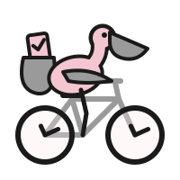

  

# Docs

bikesched is a job scheduler for Java that keeps all of its state in PostgreSQL. Every application
instance connected to the database is a *node*: nodes claim due jobs with
`SELECT … FOR UPDATE SKIP LOCKED`, so many nodes share one database without stepping on each other
and without any coordinator besides PostgreSQL.

## Concepts

- **Node**: a `Bikesched` instance. It registers in `bikesched_nodes`, sends heartbeats, polls for
  due jobs and runs them on virtual threads, up to its concurrency limit. Nodes clean up after each
  other: the running jobs of a crashed node are released and retried elsewhere.
- **Job**: a unit of work of a *type*, with an optional JSON payload, a priority, a retry limit and
  a timeout. A handler registered for the type runs it.
- **Step**: a named, durable part of a job. A completed step is not executed again when the job is
  retried; its stored result is returned instead. Steps can declare a compensation that undoes them
  if the job is cancelled or fails (a saga).
- **Recurring job**: a job type with a `Recurrence`; each run is a regular job (an *occurrence*).
- **Event**: a message with a name and a key. A job can wait for an event as a step; it is
  suspended without holding a thread until the event is published, then resumes.
- **Child job**: a job started exactly once as a step of its parent. The parent can wait for it
  without holding a thread and receives its outcome and result.

## Guarantees

- **At-least-once**: a job may run again, e.g. after its node crashed, so handlers (and
  compensations) should be idempotent. Durable steps keep completed work from being repeated.
- **Transactional scheduling**: jobs and events can be created in your own database transaction;
  they only become visible when you commit.
- **No lost events**: an event published while a job starts waiting for it is never missed, and a
  job that starts waiting after the event was published receives it right away (within the event
  retention).

## Contents

- [Getting started](getting-started/README.md): requirements, installation with Gradle or Maven,
  a first job
  - [Configuration](getting-started/configuration.md): builder options, nodes, JSON mapping
    (`bikesched-jackson`), logging
- [Jobs](jobs/README.md): scheduling, writing handlers, retries, cancellation, job history,
  timeouts
  - [Recurring jobs](jobs/recurring-jobs.md): schedules, cron expressions (`bikesched-cron`) and
    occurrences
  - [Changing handlers](jobs/changing-handlers.md): what happens to jobs in flight when a deploy
    changes their handler, safe and unsafe changes
- [Multi-step jobs](multi-step-jobs/README.md): durable steps, event waits and child jobs inside
  one job
  - [Steps and compensation](multi-step-jobs/steps.md): durable steps, sleeping, polling and sagas
  - [Events](multi-step-jobs/events.md): waiting for and publishing events
  - [Child jobs](multi-step-jobs/child-jobs.md): starting and waiting for child jobs, job results
- [Patterns](patterns.md): outbox, deduplication, rate limits, webhooks, approvals, fan-out,
  periodic work, sagas
- [Integrations](integrations/README.md): optional modules on top of the core
  - [Spring Boot](integrations/spring.md): the auto-configured node
    (`bikesched-spring-boot-starter`)
  - [Kotlin](integrations/kotlin.md): the `bikesched-kotlin` extensions
  - [Annotations](integrations/annotations.md): job handlers as `@JobHandler` methods
    (`bikesched-annotations`)
  - [Testing](integrations/testing.md): test nodes and job wait helpers (`bikesched-test`)
- [Operations](operations/README.md): running bikesched in production
  - [Admin UI](operations/admin.md): a page for jobs, steps, events and nodes with retry and
    cancel (`bikesched-admin`), and the lookups behind it
  - [Metrics](operations/metrics.md): `JobListener`, `EventListener` and the Micrometer meters
    (`bikesched-micrometer`)
  - [Database](operations/database.md): tables, indexes and migrations

The [examples](../bikesched-examples/README.md) show the concepts working together; the
[patterns](patterns.md) explain which example solves which problem. The
[decision records](decisions/README.md) explain why bikesched works the way it does.
